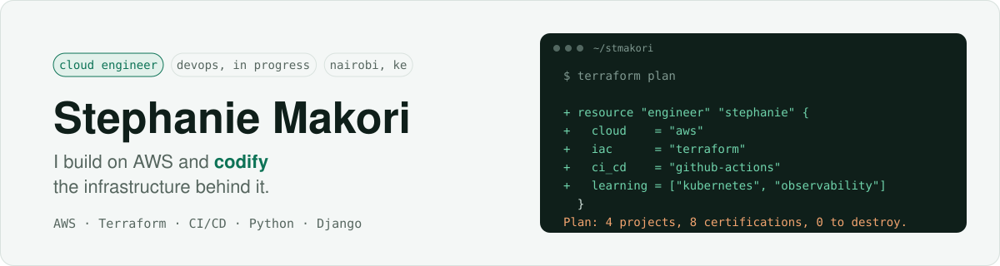

<picture>
  <source media="(prefers-color-scheme: dark)" srcset="assets/banner-dark.svg">
  
</picture>

  
  
  

I build web products for Kenya on AWS and automate the infrastructure behind them with Terraform and CI/CD.
Computer Science graduate (Egerton University), now going deeper on DevOps: Kubernetes, observability and delivery pipelines.

## ☁️ Certifications

 

## 🚀 Featured projects

| Project | What it is | Stack |
|---|---|---|
| [**Voices Against Violence**](https://github.com/stmakori/voices) · [live](https://www.voicesagainstviolence.co.ke) | GBV reporting and support platform for Kenya: anonymous reports with status tracking, a verified map of help, and an AI support companion | Django, AWS Elastic Beanstalk, Cognito, Leaflet |
| [**Cornote**](https://github.com/stmakori/Cornote_Qwen) · [demo](https://bit.ly/4AF7FcM) | Turns any PDF into Cornell notes, practice questions and an adaptive study plan, run by four autonomous Claude agents | Django, Anthropic SDK, AWS Lightsail |
| [**Terraform Challenge**](https://github.com/stmakori/Terraform_Challenge) | Day-by-day Terraform on AWS: modules, remote state, Terratest, CI plan artifacts, Sentinel and multi-region HA | Terraform, AWS, GitHub Actions, Go |
| [**ChamaHub**](https://github.com/stmakori/Chamahub) | Chama (savings group) management with M-Pesa payments and a Stellar blockchain audit trail | Django, Payhero, Stellar |

Also: [Cost Sentinel](https://github.com/stmakori/Weekend-Agent-Challenge-Cost-Sentinel), a scheduled AWS cost-anomaly agent
that writes plain-English spend summaries with Amazon Bedrock.

## 🛠️ Tools I work with

<picture>
  <source media="(prefers-color-scheme: dark)" srcset="assets/tools-dark.svg">
  
</picture>

**AWS:** EC2 · S3 · VPC · IAM · RDS · Lambda · Elastic Beanstalk · Lightsail · Cognito · Bedrock · CloudWatch · Secrets Manager
**Learning now:** Kubernetes (EKS) · observability · Go
